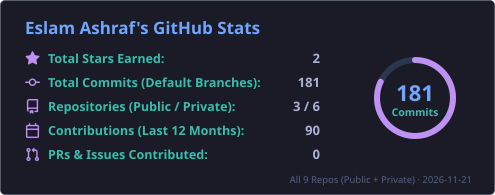
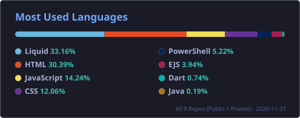

# 👨‍💻 Eslam Ashraf

### Founder & Lead Engineer @ **[Unlock Digital](https://unlockdigital.online)**
**IT Specialist • Cloud & DevOps Engineer • Mobile Systems Architect**

📍 Alexandria, Egypt 🇪🇬 &nbsp;|&nbsp; 🌐 [unlockdigital.online](https://unlockdigital.online) &nbsp;|&nbsp; 🐦 [@Es1amAshraf](https://twitter.com/Es1amAshraf)

 

---

## 🚀 About Me

I am a self-employed **IT Specialist and Full-Stack Systems Engineer** with over 5 years of hands-on experience in building high-availability e-commerce infrastructure, cloud edge security, automated licensing engines, and cross-platform native applications.

- 🏢 **Founder of [Unlock Digital](https://unlockdigital.online)** — White-label, high-availability enterprise platform for genuine digital software licenses with automated fulfillment and privacy-hardened analytics.
- 📱 **Mobile Systems Architect** — Creator of `Unlock Server Ops` (`v2.1.1`), a native Flutter DevOps & SRE client for real-time threat telemetry, persistent IP whitelist orchestration, and biometric security.
- 🛡️ **Passionate about Security & Performance** — Deep expertise in Cloudflare Edge WAF, Nginx reverse proxies (origin cloaking & A+ headers), Linux hardening (Fail2ban, UFW), CodeQL automation, and SQLite WAL concurrency.
- 🤖 **Automation & Messaging Architect** — Builder of transactional mail pipelines (Brevo API v3 + SPF/DMARC), headless WhatsApp bots (Baileys), and autonomous Telegram Sentinel watchdogs.
- 💡 **Always building & solving** — Turning complex licensing, deployment, and desktop UX issues into reliable, zero-touch tooling.

---

## 🛠️ Tech Stack & Skills

| Domain | Technologies & Tools |
| :--- | :--- |
| **Mobile & Cross-Platform** |     |
| **Backend & Runtimes** |     |
| **Databases & Storage** |   |
| **Cloud & DevOps** |       |
| **CI/CD & Security** |      |
| **Automation & Messaging** |    |

---

## 🌟 Featured Projects

### 📱 [Unlock Server Ops — Native Flutter Edition (`v2.1.1`)](https://github.com/Es1amAshraf/unlock-server-ops-flutter)
> Cross-platform mobile administration app engineered 100% in Native Flutter/Dart. Delivers sub-second SSE threat push alerts (with max-priority heads-up notifications & one-tap alert verification), persistent IP Whitelist Manager, hardware biometrics, interactive Doctor terminal pills (`PM2`, `Fail2ban`, `Nginx`), Cloudflare R2 backup sync, WAF bypass integration, and CodeQL + Dependabot CI.
- **Tech Stack**: Flutter 3, Dart, BiometricPrompt, SSE Streams, Cloudflare WAF, CodeQL, GitHub Actions CI/CD.

### 🏛️ [Unlock Digital — DevOps Infrastructure Blueprint](https://github.com/Es1amAshraf/unlock-devops-infrastructure)
> Unified DevOps and bilingual (EN/AR) architecture blueprint powering Unlock Digital. Documents Oracle Cloud ARM64 VPS (`130.61.217.8`), Cloudflare Edge WAF (330+ PoPs), Nginx reverse proxy with HTTP 444 origin cloaking, PM2 cluster, Docker microservices (Uptime Kuma, Outline VPN, Watchtower), and automated Cloudflare R2 off-site disaster recovery.
- **Tech Stack**: Oracle Cloud ARM64, Cloudflare WAF & R2, Nginx, Docker, PM2, SQLite WAL, Fail2ban.

### 🛍️ [Unlock Digital Storefront Core (`unlock-commerce`)](https://unlockdigital.online)
> White-label, zero-framework-bloat digital commerce platform running on Node.js 22 and SQLite WAL mode with a debranded Liquid SSR engine (`mtime` CDN cache-busting), **Brevo Transactional Email API v3** (scoped keys + `Reply-To`), **Meta Pixel / CAPI + GA4 + Microsoft Clarity** (with automatic PII/license masking), verified **Downloads Hub**, Baileys WhatsApp, and Telegram Sentinel Ops.
- **Tech Stack**: Node.js 22, Express, LiquidJS, SQLite WAL, Brevo API v3, Cloudflare WAF, PM2, GitHub Actions.

### 🩺 [Autodesk Licensing Doctor (`v1.5.5+`)](https://github.com/Es1amAshraf/autodesk-licensing-doctor) · [adskdoctor.unlockdigital.online](https://adskdoctor.unlockdigital.online)
> Portable diagnostic, cleanup, and recovery toolkit for Autodesk 2020+ licensing (`ADLS`, `AdSSO`, Identity Manager, WebView2, AutoCAD 2027 NLM blockers). Hardened on `main` with `ProgramData` ACL LPE fixes, Repair Zip Slip guards, and `UNDO.ps1` integrity verification, with automated Pester/PSScriptAnalyzer CI and Cloudflare Pages auto-deployment.
- **Tech Stack**: PowerShell 5.1+, WPF Bilingual GUI, Pester, Inno Setup, GitHub Actions, Cloudflare Pages.

### 🎨 [Unlock Digital Desktop Widgets (`v1.4.0+`)](https://github.com/Es1amAshraf/unlock-digital-widgets)
> Glassmorphic Windows desktop customization suite featuring Dynamic Island, macOS-style Dock & Stacks (Downloads + Recycle Bin), Live 16-bar Audio Visualizer, SMTC media controls (with strict browser-tab filtering), System HUD, Cairo Prayer Times, Weather, Focus Timer, and Quick Notes.
- **Tech Stack**: PowerShell, WinRT SMTC, C# Async Helpers, Embedded SVG Assets.

---

## 📊 GitHub & Engineering Statistics

 

---

## 📬 Connect With Me

- 🌐 **Storefront**: [unlockdigital.online](https://unlockdigital.online)
- 🩺 **AdskDoctor Portal**: [adskdoctor.unlockdigital.online](https://adskdoctor.unlockdigital.online)
- 💬 **WhatsApp**: [+20 120 589 8501](https://wa.me/201205898501)
- 🐦 **Twitter / X**: [@Es1amAshraf](https://twitter.com/Es1amAshraf)
- 💼 **GitHub**: [@Es1amAshraf](https://github.com/Es1amAshraf)

Designed & Engineered with ❤️ by Eslam Ashraf © 2026

